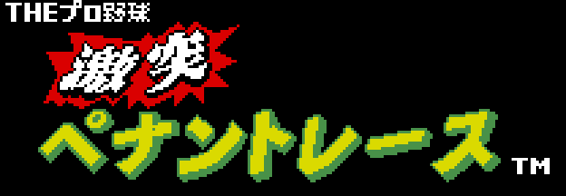

# The Pro Yakyuu Gekitotsu Pennant Race (RC-757)

*The Pro Yakyuu Gekitotsu Pennant Race* (Konami, 1988) is Konami's baseball
for the MSX2: six stock teams, games against the computer or between two
players, a league for up to six players (PENNANT) and a team editor (TEAM
EDIT) that saves to disk or to the Game Master 2's SRAM. It is a 128 KB
MegaROM with the SCC.

Here is all of its code: the 131,072 bytes, in 16 banks of 8 KB, reassemble
byte for byte, and 43.7% of the instructions are commented.

## What is on this site

- [The game](THE-GAME.html): the six teams with their cards, the rules taken
  from the code and the modes.
- [The screens](THE-SCREENS.html): the logo, the animated intro, the menu,
  the field in three zones, the pitching screen with its signs, the batter,
  the pitcher and the fielders animated, and the font, drawn from the ROM.
- [The music](THE-MUSIC.html): the 26 pieces, taken from its own engine.
- [The texts](THE-TEXTS.html): everything it writes on screen.
- [The cartridge](THE-CARTRIDGE.html): the banks, the formats of the pictures
  and texts, the sound and the saving.
- [The code](THE-CODE.html): how the disassembly is made and how it is put
  back together.
- [Findings](FINDINGS.html) and [Open questions](OPEN-QUESTIONS.html).

## No captures here

Every picture is drawn with our own code reading the cartridge's tables and
compared with the openMSX VRAM; each screen says how much matches. The tunes
come from running the cartridge's sound engine and match openMSX frame by
frame.

## Building it

You need the cartridge image, which is not distributed: `pennantrace.rom`,
the GoodMSX dump (sha1 `e22a6317...`, 131,072 bytes), in the root.
`make verify` reassembles the 16 banks and checks they come out identical.
