# What the cartridge draws

Under each picture is where it comes from and what is on it.

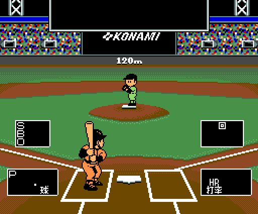

*The swing, timed as in <code>p02:8663</code>: each stance copies its sprite patterns from a store in the VRAM (<code>p00:5761</code>).*

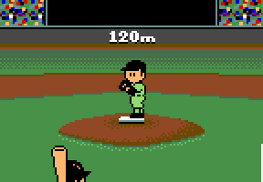

*The pitcher, steps 5 to 0 (<code>p03:A597</code>, waits from <code>p03:A83F</code>).*

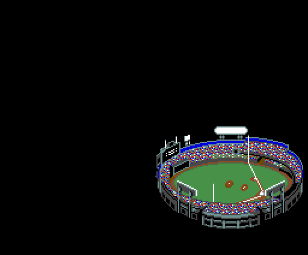

*The intro: the ball comes closer and crosses the screen uncovering the title (<code>p15:BB97</code>).*

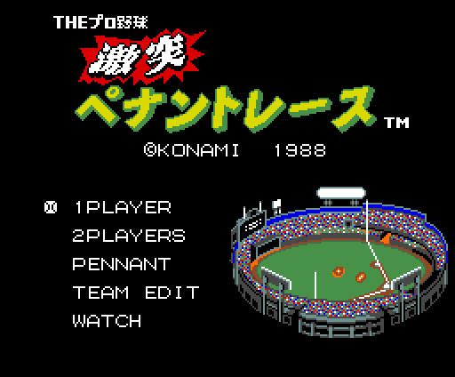

*The mode menu (<code>p01:651C</code>).*

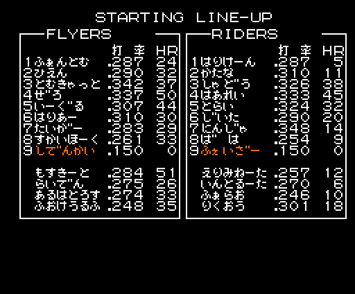

*STARTING LINE-UP (<code>p03:A2ED</code>).*

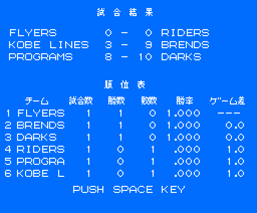

*The PENNANT results and standings (<code>p15:ADFA</code>).*

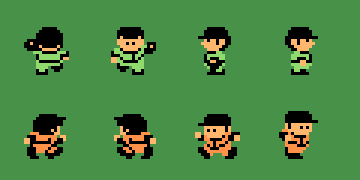

*Fielders and runners on the field, switching legs every 8 frames (<code>p01:7280</code>, <code>p02:8FC8</code>).*

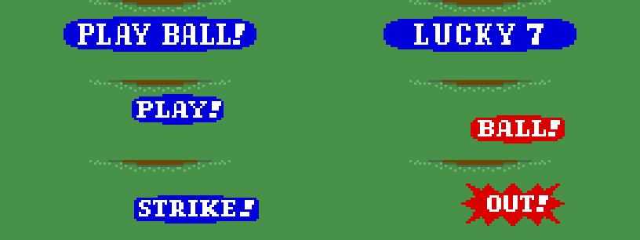

*The pitching signs (<code>p00:5163</code>-<code>p00:51A1</code>).*

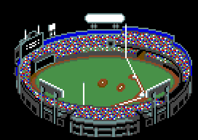

*The stadium of the intro (<code>p15:BB97</code>).*

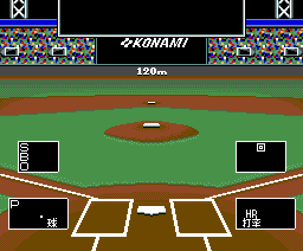

*The pitching screen, from behind home plate (<code>p01:6352</code>).*

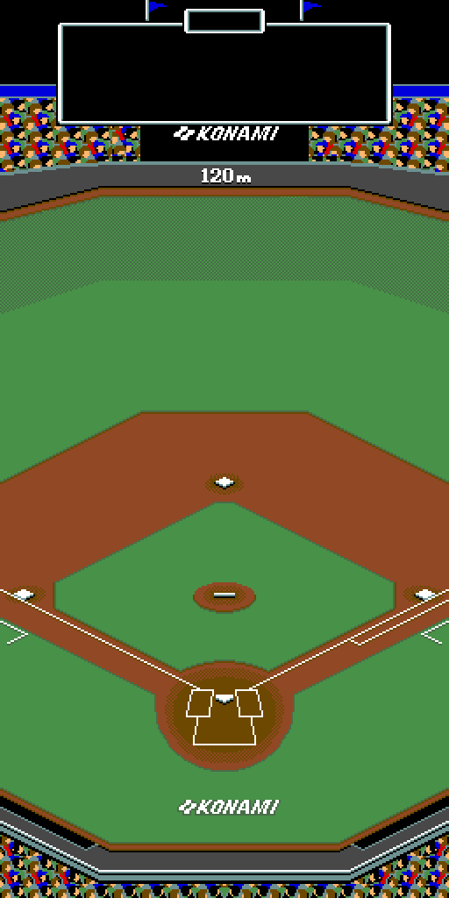

*The field, centre zone: 256 &times; 512 pixels (<code>p08:9432</code>).*

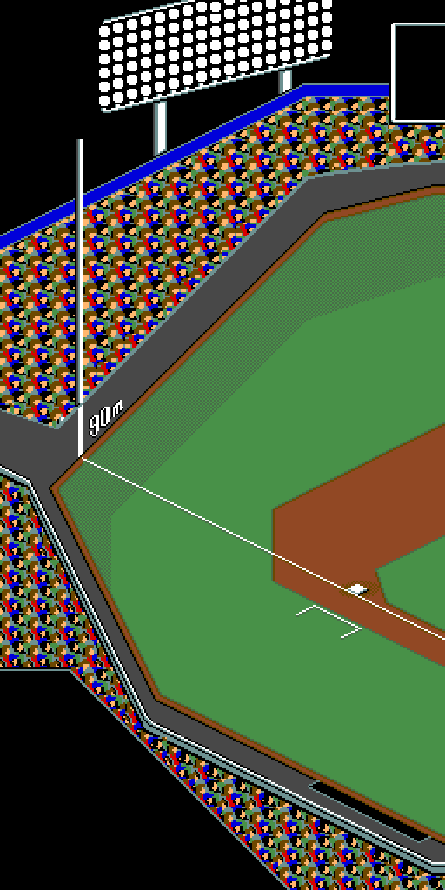

*The left field zone.*

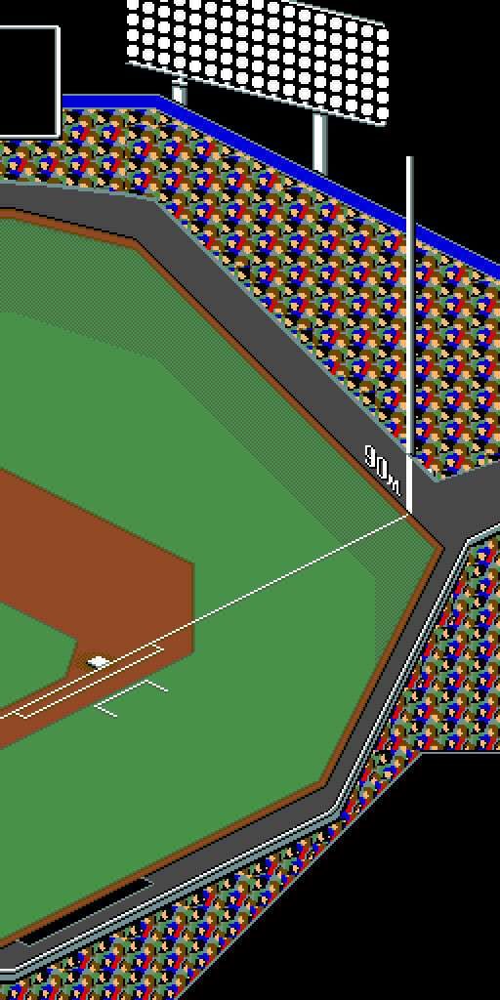

*The right field zone.*

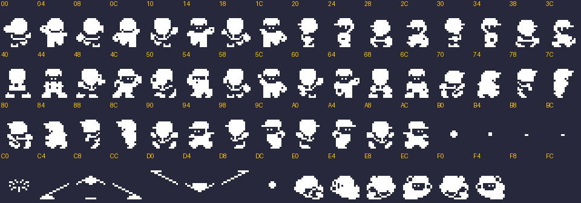

*The sprite patterns of a game (<code>p00:537C</code>, <code>p00:539D</code>, <code>p00:53CC</code>).*
