# The screens

All of them are drawn with our own code (`tools/vram.py`,
`tools/pantallas.py`, `tools/sprites.py` and `tools/animaciones.py`)
following the steps of the routine that paints them, cited for each one. None
is a capture. Each one has been compared with the openMSX VRAM dumped with the
game running (`tools/omsx_vram.tcl`, `tools/coteja_vram.py`); under each one
is how much matches.

The game runs in SCREEN 5 on the V9938 (256 × 212 pixels, 16 colours). Almost
everything is drawn in two steps: first the graphics are built on page 1 of
the VRAM (the "sheet", 32 characters per row) and then copied to the visible
page with VDP commands.

## The Konami logo

`p03:B670` builds the logo on page 1 (`p00:57C6`: three strips of one-bit
characters and the list at `p09:BCA5`, with the palette at `p09:BE86`) and
`p14:872E` uncovers it: every two frames it copies one more row, up to 48, to
page 0. **Checked: 0 bytes different** in two dumps.

## The intro

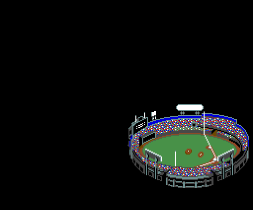

`p15:BB97`, frame by frame. First the stadium alone, 32 frames. Then a ball
comes out of it towards the viewer (`p15:BD99`: position and speed; every
frame it slows down, and every 8 it switches to a bigger shape, 1 to 4 pieces
of two sprites, `p15:BD13` and `p15:BD31`). Then, with other sprite patterns
(`p00:5421`), a spinning 64 × 64 ball (two shapes taking turns every 8 frames)
crosses the screen at 4 pixels a frame, and behind it the title is copied
from page 1, column by column (`p15:BC39`). **Checked** against the dump of
the crossing: page 0 identical and the 32 sprite attributes identical (the
last 8 one frame behind: the game copies them to the VRAM in two batches,
`p00:42A1`).

The "THEプロ野球 激突ペナントレース" title (`p00:52E7`): the pictures at
`p09:B07A` and the character list at `p09:B6B9`, built on page 1. **Checked:
0 bytes different.**

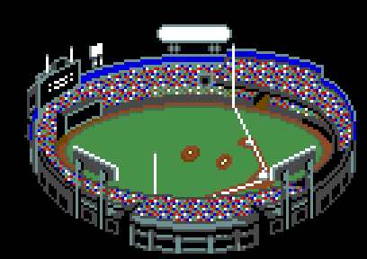

The stadium (`p00:5427`): the pictures at `p09:A619` and 16 × 11 characters in
runs from `p09:AFC4`, with the palette at `p07:6000`. **Checked: 0 bytes
different.**

## The menu

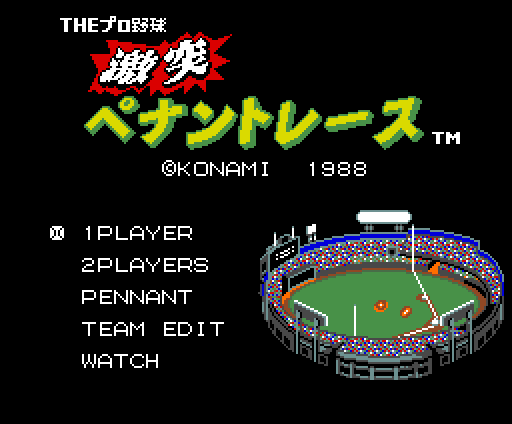

`p01:651C`: the finished intro, the title copied from page 1 to (0x1C, 0x08),
the five texts in a row at `p13:7D8F` and the marker, character 0x9A, on the
row of the chosen mode (`p01:65AF`). With a disk drive and a Game Master 2 a
sixth one appears, MEDIA SELECT. **Checked: 0 bytes different.**

## The menus

The screens before and after a game. What changes from one session to
another (the chosen teams, the option, the results) and the palette of that
moment come from the RAM of an openMSX dump (`tools/estados_menus.json`);
everything else from the code: `tools/menus.py` repeats its routines and
`tools/coteja_menus.py` compares. **All eight checked: 0 bytes different** on
the visible page.

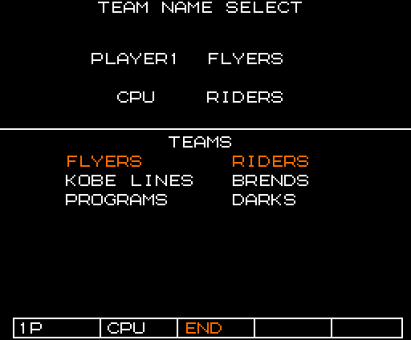

Choosing the teams (`p15:A470`): the title by mode, the two-column team list
(`p13:6A0D`), with the chosen ones in colour 4, and the option bar
(`p15:A67A`).

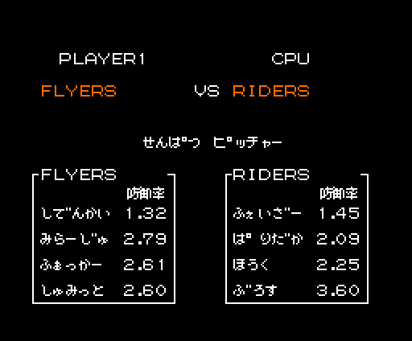

The starting pitchers (`p02:9EA9`): the game sign (`p14:9787`) and each
team's four pitchers with their 防御率 (`p02:9F20`).

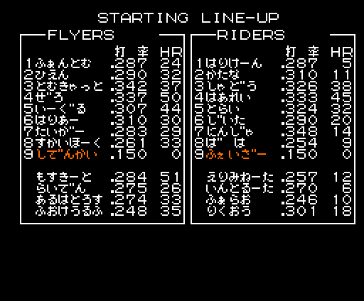

STARTING LINE-UP (`p03:A2ED`): each team's 12 fielders, with the names in
narrow letters (the dakuten moves 4 pixels, `p03:A425`), and the pitcher on
row 9, in colour 4 (`p03:A242`).

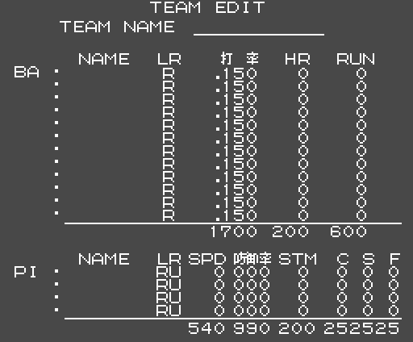

TEAM EDIT with a new team (`p03:B9E7`): the grey background, the text at
`p13:7EC6` with the caps and the columns of starting values (`p14:8654`).

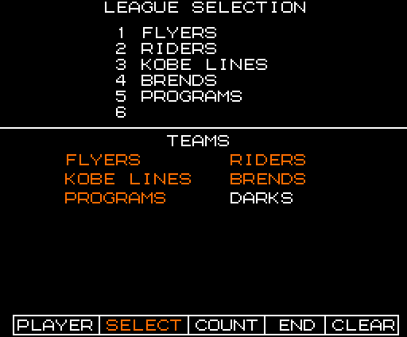

LEAGUE SELECTION (`p13:61BD`): the league's teams, numbered, and the list of
the six.

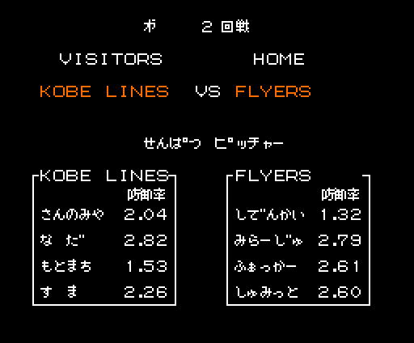

In PENNANT the pitchers screen carries the round (第 2 回戦, `p14:971A`) and
VISITORS / HOME.

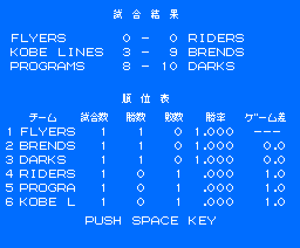

The round's results and the standings (`p15:ADFA`): the player's game, the
other two drawn by lot, and the table with games, wins, losses, percentage (a
four-step long division, `p15:AFBD`) and games behind the leader
(`p15:B034`).

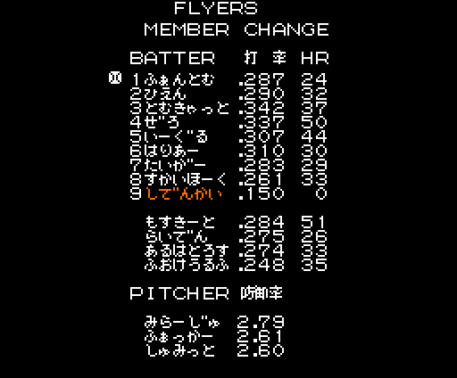

The visitors' substitution screen (`p14:9BCC`), opened from the pause: the 17
on their list (batting order, bench and pitchers, with their gaps) and the
mark on the batter.

## The field

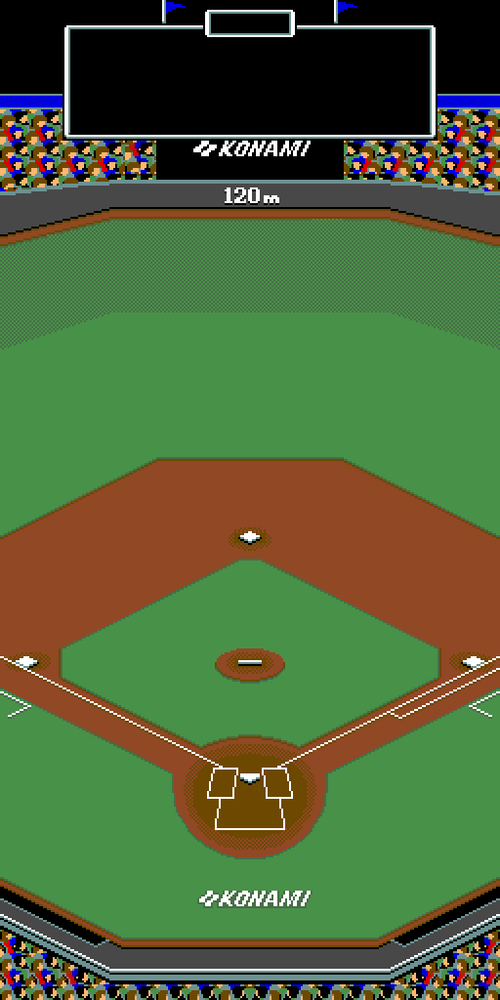

The field has three zones: the centre and the two sides. Each one is 256 ×
512 pixels and is a map of 16 × 8 tiles of 4 × 4 characters (`p08:9432`); the
tiles come from `p08:95B8` (and from `p08:9A58` in the last two strips of the
list). The screen shows part of the zone at a time. **Checked: centre zone,
the 256 lines that were in the VRAM, identical in two dumps;** in another
three, 8 to 22 lines differ: the signs and strips the game was drawing at that
moment.

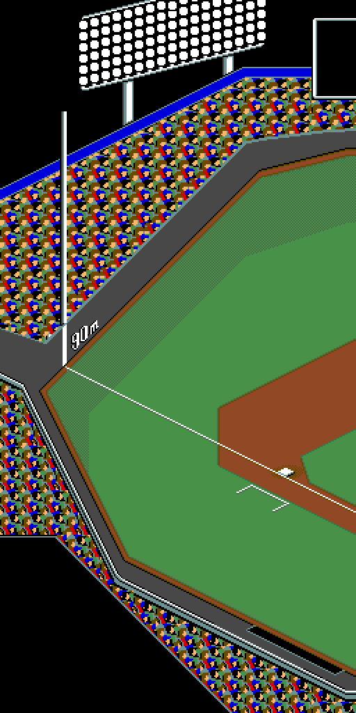

The left field zone (tiles at `p08:9B28`). **Checked: all 256 lines
identical** in a dump of a WATCH game.

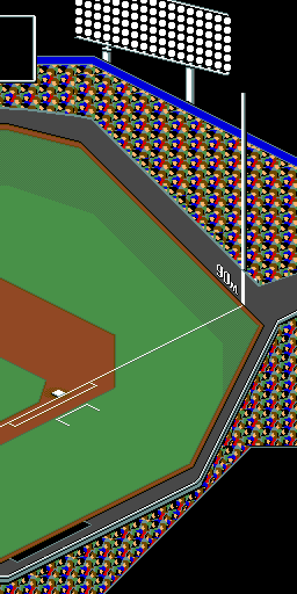

The right field zone (tiles at `p09:A088`). **Checked: 248 of 256 lines
identical**; on the other 8 the game had written " OUT " on top at (112, 240)
(`p13:7E69`), and drawing that text gives exactly what is in the dump.

## The pitch

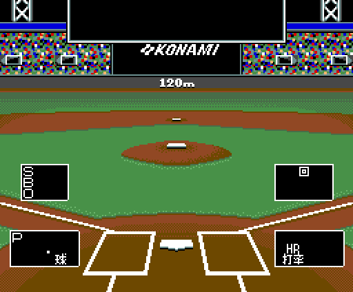

The pitching screen, seen from behind home plate (`p01:6352`): the background
in runs from `p08:9220`, two frames and the text at `p13:7E1E` (S B O, the 回
of the inning, HR and 打率). With no game going, the boxes and figures are
empty. **Checked: 818 of 864 blocks identical**; the rest is the little bases
window and the figures of the game being played.

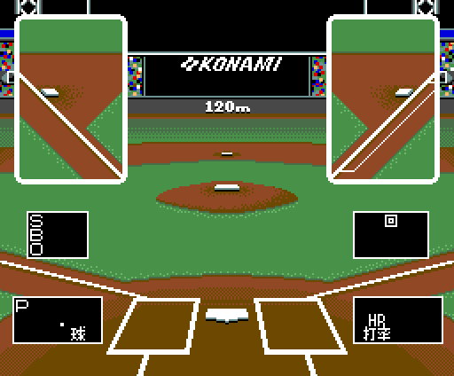

With runners on, the screen carries two little windows with first and third
base (`p03:AD46`): 8 × 12 characters from row 0xA8 of the sheet, from the runs
at `p08:9178` and `p08:91CC`; the runner waiting in each is a sprite
(`p02:988A`). **Checked: identical byte for byte** in the dumps of a WATCH
game.

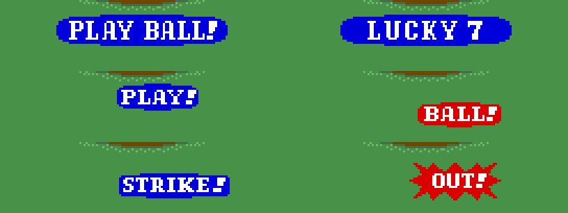

The signs are drawn on it as picture lists, in blue or red (the palettes at
`p00:51B2`), each with a twin for a batter on the other side: PLAY BALL! when
a half inning starts (`p13:7925`), LUCKY 7 in the seventh (`p11:96EE`), PLAY!
(`p13:BA9B`), BALL! (`p11:9401`), STRIKE! (`p11:94BB`) and OUT!
(`p11:95A8`). **All six checked**, identical byte for byte in the dumps
where they appear; LUCKY 7 by setting the seventh inning in RAM (0xE19B =
0x0C) before the game starts.

## The players

The players are V9938 mode-2 sprites: 16 × 16 pixels, one colour per line, and
two sprites in the same place, the second with the CC bit, mix their colours.
The game keeps the attributes in RAM (`0xE100`); their fourth byte is not a
colour but an index: `p00:5B1F` unpacks its run from `p09:BC05` into the
sprite's 16 line colours. Each player is an outline sprite (index 7) and a
shirt sprite: 0x18 for the home team and 0x1B for the visitors, palette
colours 8 and 11, which come from the team (`p00:5517`, the table at
`p09:BFDE`: FLYERS blue, RIDERS orange, KOBE LINES green, BRENDS light blue,
PROGRAMS white, DARKS grey). Here, the demo's: RIDERS against KOBE LINES.
**Checked:** the colours of the 463 visible sprites in the dumps come out of
`p09:BC05` identical.

### The batter

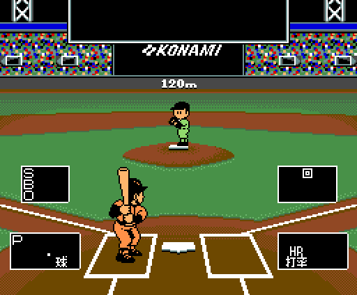
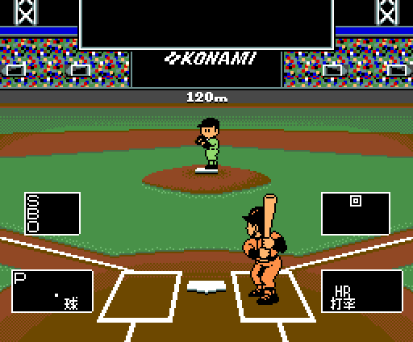

The batter is 18 or 20 sprites. At every new ball (`p02:8860`), `p00:5677`
unpacks his pattern store into an off-screen part of page 0 (`0x6C00`:
`p10:604D` and `p10:7C4B`, or `p10:6808` and `p10:7ECB` batting left). Each
stance (0-6) copies 64-byte half lines from there to the sprite pattern table,
following the 11-byte entry at `p10:6000` (`p00:5761`), and sets its
attributes (`p11:9911`, or `p11:991F` batting left; `p00:5877`). The swing
(`p02:8663`): at rest stance 4; with the button, every 2 frames 3, 2, 1 and
0; on release, every 3 frames back. In phase 2 the stance is 5 with the stick
up and 6 down (`p00:584F`).

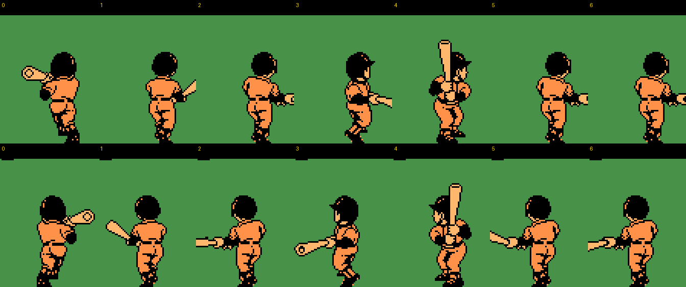

The seven stances on both sides. **Checked:** the patterns and attributes of
stances 0 and 4 on both sides, identical byte for byte in the dumps.

### The pitcher

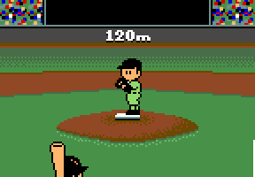
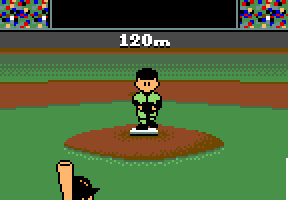

The pitcher is 4 sprites. `p00:56C4` copies the 7 poses of his style
(`p10:6FBE`, 4 styles; left-handers, mirrored) to lines 0xF9-0xFF of page 0,
and whenever the motion step (0xE1D3) changes `p00:56B1` copies that pose's
line to sprite patterns 0xB0-0xBF. The step starts at 5 (`p03:AA11`) and goes
down with the waits at `p03:A83F` (16, 16, 20 and 24 frames); at 1 the ball
leaves. The attributes of each step come from `p11:9DB2`.

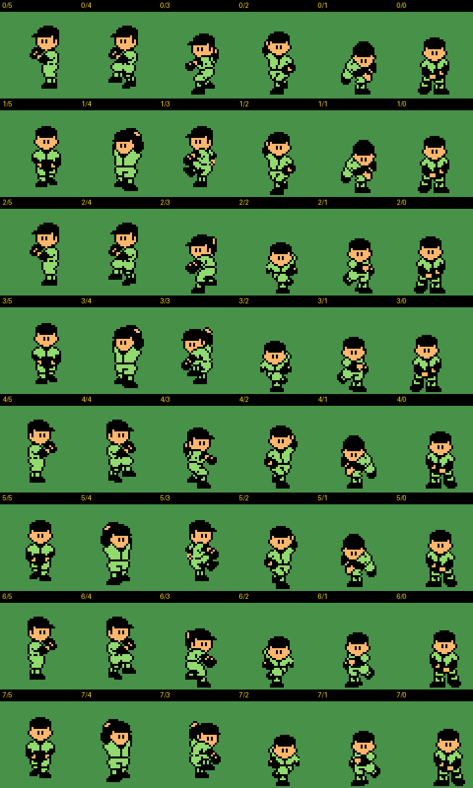

The 4 styles and their mirrors, steps 5 to 0. **Checked:** the pose and the 4
attributes, identical byte for byte in 18 dumps, with steps 0 to 5.

### On the field

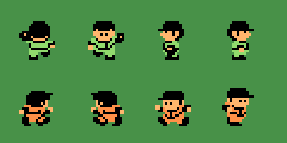

On the field each player is two sprites: pattern d with the outline and d + 4
with the shirt (`p01:7594`). Fielders go by direction (`p01:7280`: up 0x00,
down 0x10, left 0x20, right 0x30) and runners the same from 0x70
(`p02:8FC8`); bit 3 of the 0xED0E counter, which changes every 8 frames,
alternates the legs.

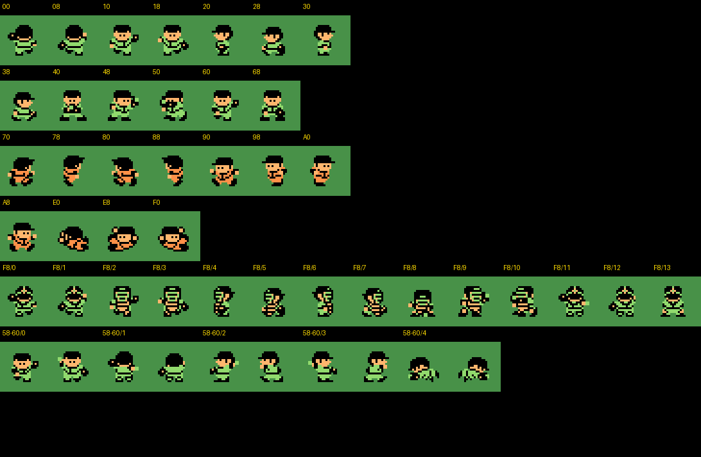

All the poses: fielders (and crouching, 0x40), runners and their slides (0xE0
+ 8 per base, `p02:8C74`), the catcher's 14 (`p00:5716`, `p11:8759`) and the
5 of whoever holds the ball (`p00:572E`, `p11:8499`). The patterns are the
game's (`p00:537C`, `p00:539D`, `p00:53CC`), **checked: identical** in the
field dumps except those the game changes on the fly.

## The sprite patterns

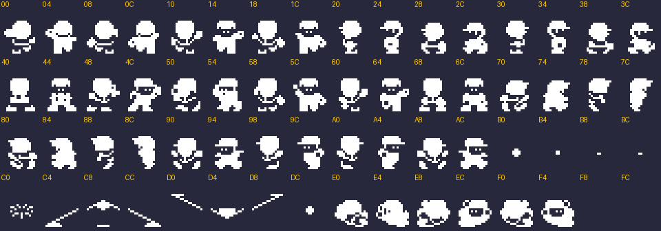

The game's 64 patterns of 16 × 16 (VRAM `0xF800`-`0xFFFF`), in a single
colour. On top of them, `p00:572E` puts the ball holder's at `0xFAC0` and
`p00:5716` the catcher's at `0xFFC0`.

## The font

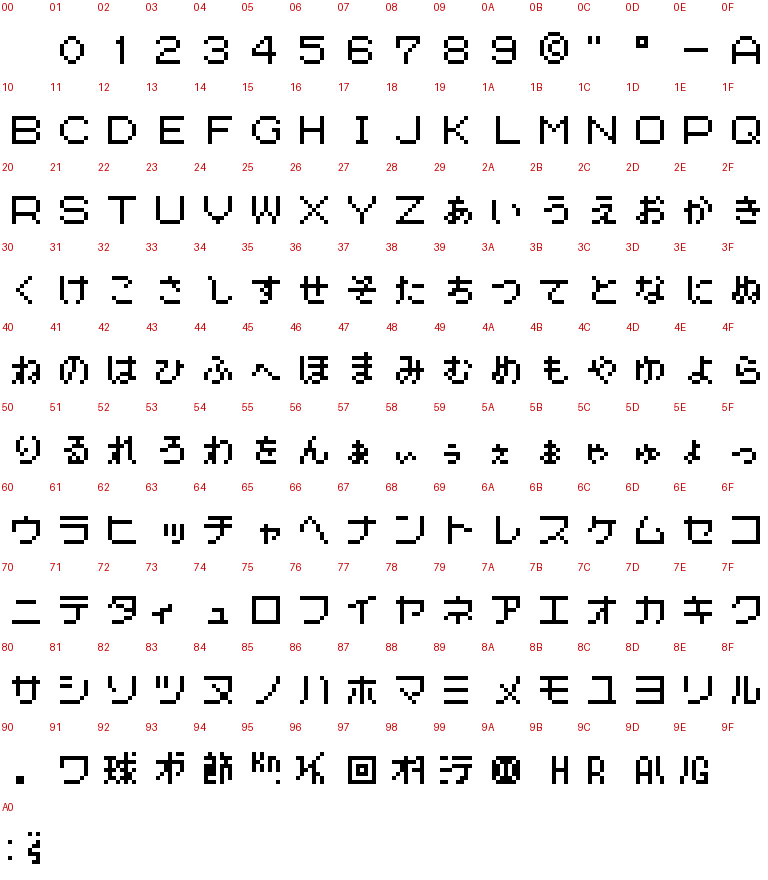

161 one-bit characters at `p12:B6C3`: digits, letters, hiragana, katakana and
signs. They are put twice on the sheet, the second time in colour 4. On top
go two kanji sets: 17 from `p09:B942` for the game (戦打数安本塁三振四死球盗失策防御率)
and 11 from `p09:B9DA` for the PENNANT screens (試合結果勝敗差順位表 and a
quote mark).
