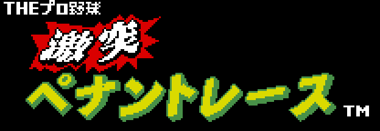

# Under the hood

## The Pro Yakyuu Gekitotsu Pennant Race (RC-757)

*The Pro Yakyuu Gekitotsu Pennant Race* (Konami, 1988) is Konami's baseball
for the MSX2: six stock teams, games against the computer or between two
players, a league for up to six players (PENNANT) and a team editor (TEAM
EDIT) that saves to disk or to the Game Master 2's SRAM. It is a 128 KB
MegaROM with the SCC.

Here is all of its code: the 131,072 bytes, in 16 banks of 8 KB, reassemble
byte for byte, and 43.7% of the instructions are commented.

### What is on this site

- [The game](THE-GAME.html): the six teams with their cards, the rules taken
  from the code and the modes.
- [The screens](THE-SCREENS.html): the logo, the animated intro, the menu,
  the field in three zones, the pitching screen with its signs, the batter,
  the pitcher and the fielders animated, and the font, drawn from the ROM.
- [The music](THE-MUSIC.html): the 26 pieces, taken from its own engine.
- [The texts](THE-TEXTS.html): everything it writes on screen.
- [The cartridge](UNDER-THE-HOOD.html): the banks, the formats of the pictures
  and texts, the sound and the saving.
- [The code](UNDER-THE-HOOD.html): how the disassembly is made and how it is put
  back together.
- [Findings](CURIOSITIES.html) and [Open questions](CURIOSITIES.html).

### No captures here

Every picture is drawn with our own code reading the cartridge's tables and
compared with the openMSX VRAM; each screen says how much matches. The tunes
come from running the cartridge's sound engine and match openMSX frame by
frame.

### Building it

You need the cartridge image, which is not distributed: `pennantrace.rom`,
the GoodMSX dump (sha1 `e22a6317...`, 131,072 bytes), in the root.
`make verify` reassembles the 16 banks and checks they come out identical.

## The cartridge

### The banks

128 KB in 16 banks of 8 KB with the Konami SCC mapper: four windows
(`0x4000`, `0x6000`, `0x8000` and `0xA000`) switched by writing the bank
number to `0x5000`, `0x7000`, `0x9000` and `0xB000`. Bank `0x3F` at `0x9000`
opens the SCC at `0x9800`-`0x98FF`.

Bank 0 always stays at `0x4000` and the other three windows are set three at
a time: 1-2-3 (`p00:438D`), 7-8-9 (`p00:4392`), 10-11-12 (`p00:4397`) and
13-14-15 (`p00:439F`). The current set is kept at `0xDDF1`-`0xDDF3`. The
sound puts banks 4-5-6 in for a moment and goes back to the previous set.

| banks | what is there |
|---|---|
| p00 | the core: start-up, the interrupt, the state dispatcher (`p00:4220`), the VDP, pictures, texts and sound requests |
| p01-p03 | the game: pitching, batting, runners, fielding, camera, scoreboard and batting order |
| p04-p06 | the sound: the table of 72 sounds (`p04:600C`), the scores (p05) and the engine (p06) |
| p07-p12 | the graphics: palettes, pictures, the field map (`p08:9432`) and its tiles, the kanji (p09), the sprites (p10-p11) and the font (p12) |
| p13-p15 | the menus, PENNANT, TEAM EDIT, saving, the intro and the six teams (`p13:731F`) |

### The pictures

Almost everything on screen comes from picture lists (`p00:4FA3`): a number
of entries and, per entry, 6 bytes `[palette-type][VRAM][n][pointer]`. The
type says how many bits each pixel has: 0 and 1, one bit; 2 and 3, two; 4 and
5, three. Odd types are drawn mirrored. The high nibble picks the palette in a
table that gives 2, 4 or 8 colours; each bit combination is one of them.

Large things go in runs (`p00:4B35`): a count byte; 0 ends, with bit 7 clear
it repeats the next byte, `0x80` brings a new destination and `0x81` to
`0xFF` copy the bytes as they are.

### The texts

`p00:4EA6` and its sisters put banks 13-14-15 in and read `[x y]` and font
characters up to `0xFF`; `0xFE` brings another position and `0xFD` is a half
space. See [The texts](THE-TEXTS.html).

### The sound

Each sound has a header (`p04:600A` + 2 × number): a channel mask (bit 7
channel 1, bit 0 channel 8; 1 to 3 are the PSG, 4 to 8 the SCC), a priority
and a pointer to each channel's score. In the scores, `0xD0` to `0xFE` are
commands (`p06:B92F`: the octave, the priority and others through a table),
what is below are notes and `0xFF` ends. The engine steps each channel in the
interrupt (`p06:B41E`) and writes the PSG and the SCC (`p06:BBB8`). See
[The music](THE-MUSIC.html).

### Saving

TEAM EDIT and PENNANT save to one of three places: RAM, disk or the Game
Master 2's SRAM (`p13:6007`).

- **Disk** goes through the BDOS (`0xF37D`). Before each call the game's RAM
  that DOS would overwrite is moved aside (`p14:8334`) and put back after.
- **The Game Master 2** is searched for in the four slots and their subslots:
  it is the cartridge with `YZ` at `0x4010` (`p13:709A`). To use it, the game
  puts its bank 4 at `0x8000` and calls `0x8000` with the command in C: 5 the
  directory, `0x0A` save and `0x0B` load (`p13:721D`). The league is saved
  under the name `PENAN`. Meanwhile it removes the H.KEYI hook (H.TIMI for the
  directory).

## The code

One listing per bank in `src/pennantrace_pNN.asm` (p00 to p15), assembled with
pasmo, which comes out identical to the ROM: `make verify`. 100% of the binary
is explained: 50,191 bytes of code and 80,881 of data. Of the 25,026
instructions, 43.7% are commented, and none of the 2,933 routines is below the
comment minimum. Every bank with code is over 40%.

### How it is made

- `tools/z80trace.py` walks the code from its entry points (start-up, the
  interrupt and the dispatchers) and separates code from data.
- `tools/bancos.py` and `tools/cartucho.py` know which bank is in each window:
  the sets of three, the jumps between banks and the routines that return with
  another set (`tools/colas.py`).
- Data is identified by who reads it (`tools/lectores.py`): pictures, runs,
  texts, palettes, tiles, sound headers and scores.
- `tools/anota.py` comments the variables, the BIOS, the calls and the cards
  of the players on the field; `tools/check_refs.py` checks that every
  `pNN:XXXX` reference in the comments lands on an instruction or a data block
  of that bank.
- 12 tests (`tests/`) and `make sanity` watch the build and the trace.

### The pictures and the music

- `tools/vram.py` is a V9938 VRAM in Python with what the game uses: pictures,
  runs, one-bit characters, copy commands and palettes. `tools/pantallas.py`
  repeats step by step the routines that paint each screen.
  `tools/sprites.py` draws sprites the way the V9938 does (with the CC bit)
  and builds the batter and the pitcher the way the game does;
  `tools/animaciones.py` writes the GIFs with the code's timing.
  `tools/omsx_vram.tcl` dumps the openMSX VRAM and `tools/coteja_vram.py`
  compares.
- `tools/musica.py` runs the sound engine on a Python Z80 and writes the MP3s;
  `tools/omsx_psg.tcl` and `tools/coteja_psg.py` check them against openMSX.
  The probe lets a single game request through, can zero RAM bytes every frame
  (the free tone) and diverts the engine start-up after the first time.
- `tools/textos.py`, `tools/equipos.py` and `tools/fuente.py` take out the
  texts, the teams and the font.

## Code shared with other Konami cartridges

This disassembly has been compared, instruction by instruction, with
every other Konami one in the series. A block counts when the same
instructions, at least six of them from a label to its `ret` or its
unconditional jump, are in both cartridges; the addresses are left
aside, because they change from one cartridge to the next. Of the
other 57, **46** have at least one block in common with this one;
these are the ones that share the most:

| Cartridge | Blocks | Instructions | For example (here = there) |
|---|---:|---:|---|
| [Gekitotsu Pennant Race 2](https://antxiko.github.io/PennantRace2-disassembly/) | 119 | 1,758 | `dibujos` (p00:4FA3) |
| [King's Valley II](https://antxiko.github.io/KingsValley2-disassembly/) | 85 | 1,378 | `rachas_con_destino` (p00:4B2D) |
| [Parodius](https://antxiko.github.io/Parodius-disassembly/) | 71 | 1,189 | `sonido` (p00:57FF) = `pide_sonido` |
| [Salamander - Operation X](https://antxiko.github.io/Salamander-disassembly/) | 70 | 1,140 | `sonido` (p00:57FF) = `pide_sonido` |
| [Nemesis 3 - The Eve of Destruction](https://antxiko.github.io/Nemesis3-disassembly/) | 61 | 973 | `cartucho_en_pagina_2` (p00:43EC) = `cartucho_en_8000` |
| [Konami’s Game Master 2](https://antxiko.github.io/GameMaster2-disassembly/) | 59 | 976 | `rectangulo_desde_ram` (p00:4DAA) = `vdp_hmmc` |
| [Contra](https://antxiko.github.io/Contra-disassembly/) | 56 | 1,007 | `nota_empieza` (p06:B6AF) |
| [Hai no Majutsushi - Mahjong 2](https://antxiko.github.io/Majutsushi-disassembly/) | 52 | 581 | `cartucho_en_pagina_2` (p00:43EC) = `cartucho_en_8000` |
| [Shalom: Knightmare III](https://antxiko.github.io/Shalom-disassembly/) | 43 | 539 | `cartucho_en_pagina_2` (p00:43EC) = `cartucho_en_8000` |
| [F-1 Spirit — The Way to Formula 1](https://antxiko.github.io/F1Spirit-disassembly/) | 41 | 704 | `canal_ocupa` (p06:B305) = `SONIDO_CANAL` |

The whole matrix, the 58 cartridges against each other, is on
[The routines](https://antxiko.github.io/MSX-disassembly-database/THE-ROUTINES.html) in the series database, along
with the method and the program that measures it.
