# Lo que el cartucho dibuja

Debajo de cada imagen está de dónde sale y qué se está viendo.

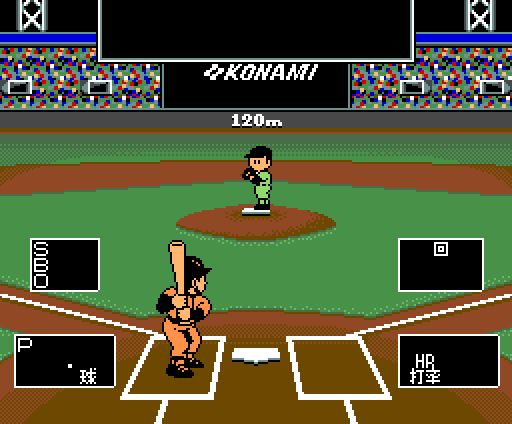

*El swing, con los tiempos de <code>p02:8663</code>: cada formaci&oacute;n copia sus dibujos de sprite de un almac&eacute;n de la VRAM (<code>p00:5761</code>).*

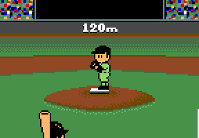

*El lanzador, pasos 5 a 0 (<code>p03:A597</code>, esperas de <code>p03:A83F</code>).*

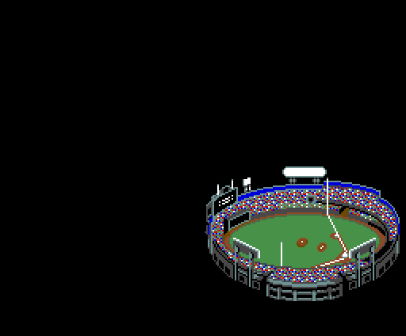

*La presentaci&oacute;n: la pelota se acerca y cruza destapando el r&oacute;tulo (<code>p15:BB97</code>).*

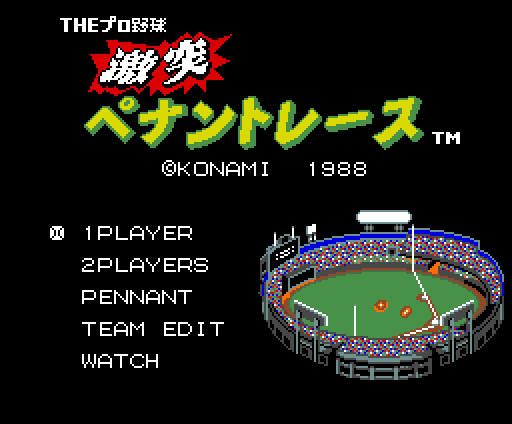

*El men&uacute; de modos (<code>p01:651C</code>).*

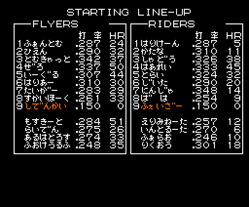

*STARTING LINE-UP (<code>p03:A2ED</code>).*

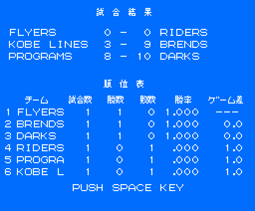

*Los resultados y la clasificaci&oacute;n de PENNANT (<code>p15:ADFA</code>).*

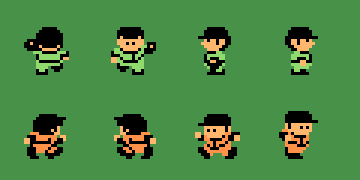

*Defensores y corredores en el campo, cambiando de pierna cada 8 cuadros (<code>p01:7280</code>, <code>p02:8FC8</code>).*

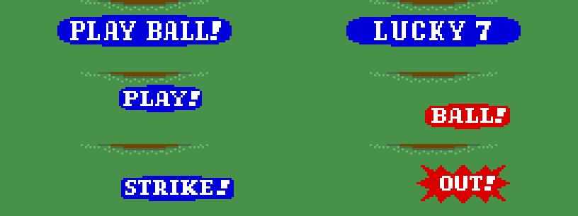

*Los letreros del lanzamiento (<code>p00:5163</code>-<code>p00:51A1</code>).*

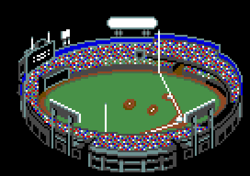

*El estadio de la presentaci&oacute;n (<code>p15:BB97</code>).*

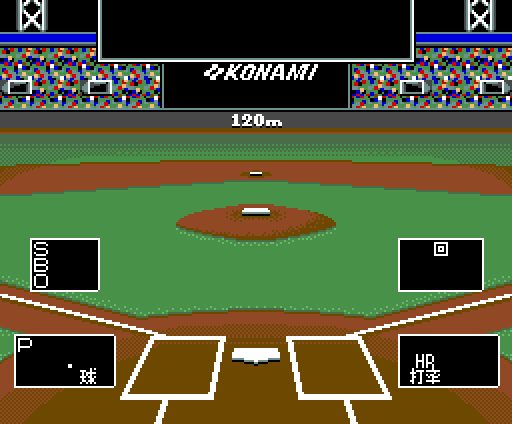

*La pantalla del lanzamiento, desde detr&aacute;s de la casa (<code>p01:6352</code>).*

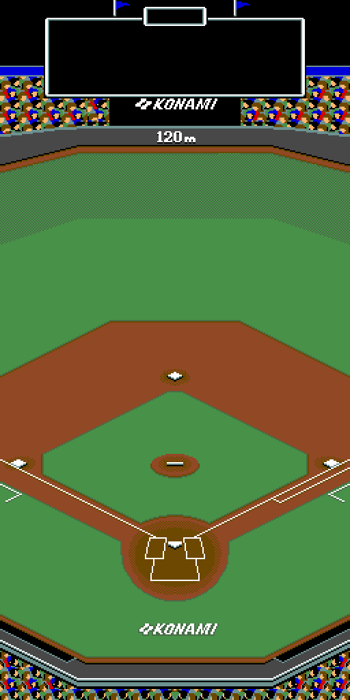

*El campo, zona del centro: 256 &times; 512 puntos (<code>p08:9432</code>).*

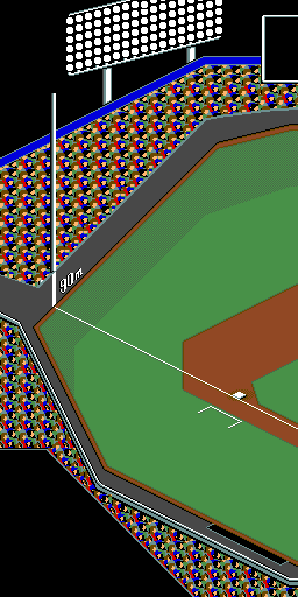

*La zona del jard&iacute;n izquierdo.*

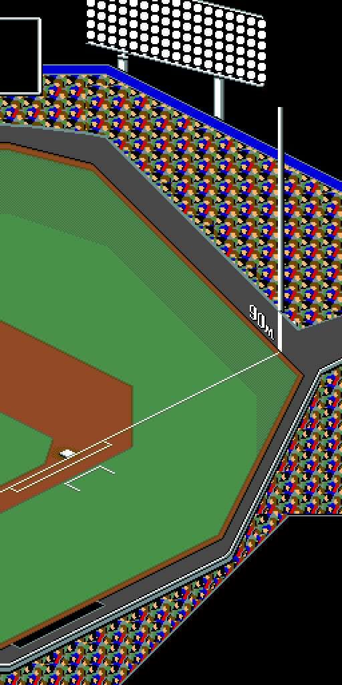

*La zona del jard&iacute;n derecho.*

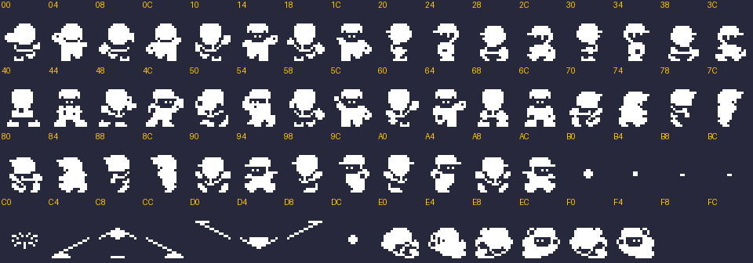

*Los patrones de los sprites del partido (<code>p00:537C</code>, <code>p00:539D</code>, <code>p00:53CC</code>).*
