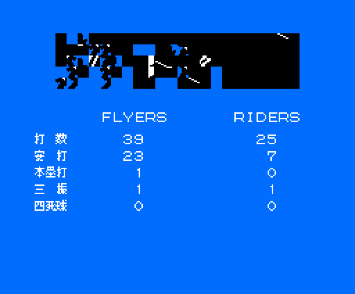

# Las pantallas

Todas están dibujadas con código propio (`tools/vram.py`,
`tools/pantallas.py`, `tools/sprites.py` y `tools/animaciones.py`) siguiendo
los pasos de la rutina que las pinta, citada en cada una. Ninguna es una
captura. Cada una se ha comparado con la VRAM de openMSX volcada con el juego en
marcha (`tools/omsx_vram.tcl`, `tools/coteja_vram.py`); debajo de cada una está
cuánto coincide.

El juego va en SCREEN 5 del V9938 (256 × 212 puntos, 16 colores). Casi todo se
pinta en dos pasos: primero se montan los gráficos en la página 1 de la VRAM
(la «hoja», de 32 caracteres por fila) y luego se copian a la página que se ve
con las órdenes del VDP.

## El logo de Konami

`p03:B670` monta el logo en la página 1 (`p00:57C6`: tres tiras de caracteres
de un bit y la lista de `p09:BCA5`, con la paleta de `p09:BE86`) y
`p14:872E` lo destapa: cada dos cuadros copia una fila más, hasta 48, a la
página 0. **Cotejado: 0 bytes distintos** en dos volcados.

## La presentación

`p15:BB97`, cuadro a cuadro. Primero el estadio solo, 32 cuadros. Luego una
pelota sale de él y se acerca (`p15:BD99`: posición y velocidad; cada cuadro
frena, y cada 8 cambia a una forma más grande, de 1 a 4 piezas de dos sprites,
`p15:BD13` y `p15:BD31`). Después, con otros dibujos de sprite (`p00:5421`),
una pelota de 64 × 64 que gira (dos formas que se turnan cada 8 cuadros)
cruza la pantalla a 4 puntos por cuadro, y detrás de ella se copia el rótulo
de la página 1, columna a columna (`p15:BC39`). **Cotejado** con el volcado del
cruce: la página 0 igual y los 32 atributos de sprite iguales (los 8 últimos,
un cuadro por detrás: el juego los copia a la VRAM en dos tandas,
`p00:42A1`).

El rótulo «THEプロ野球 激突ペナントレース» (`p00:52E7`): los dibujos de
`p09:B07A` y la lista de caracteres de `p09:B6B9`, montados en la página 1.
**Cotejado: 0 bytes distintos.**

El estadio (`p00:5427`): los dibujos de `p09:A619` y 16 × 11 caracteres en
rachas de `p09:AFC4`, con la paleta de `p07:6000`. **Cotejado: 0 bytes
distintos.**

## El menú

`p01:651C`: la presentación terminada, el rótulo copiado de la página 1 a
(0x1C, 0x08), los cinco textos seguidos de `p13:7D8F` y el marcador, el
carácter 0x9A, en la fila del modo elegido (`p01:65AF`). Con disco y Game
Master 2 sale un sexto, MEDIA SELECT. **Cotejado: 0 bytes distintos.**

## Los menús

Las pantallas de antes y después del partido. Lo que cambia de una partida a
otra (los equipos elegidos, la opción, los resultados) y la paleta de ese
momento salen de la RAM de un volcado de openMSX (`tools/estados_menus.json`);
todo lo demás, del código: `tools/menus.py` repite sus rutinas y
`tools/coteja_menus.py` compara. **Cotejadas las nueve: 0 bytes distintos** en
la página que se ve.

La elección de equipos (`p15:A470`): el título según el modo, la lista de
equipos de dos columnas (`p13:6A0D`), con los elegidos en el color 4, y la
barra de opciones (`p15:A67A`).

Los lanzadores iniciales (`p02:9EA9`): el letrero del partido
(`p14:9787`), y los cuatro lanzadores de cada equipo con su 防御率
(`p02:9F20`).

STARTING LINE-UP (`p03:A2ED`): los 12 de campo de cada equipo, con los
nombres en letra estrecha (el dakuten avanza 4 puntos, `p03:A425`), y el
lanzador en la fila 9, en el color 4 (`p03:A242`).

TEAM EDIT con un equipo nuevo (`p03:B9E7`): el fondo gris, el texto de
`p13:7EC6` con los topes y las columnas de los valores de partida
(`p14:8654`).

LEAGUE SELECTION (`p13:61BD`): los equipos de la liga, numerados, y la lista
de los seis.

En PENNANT, la pantalla de los lanzadores lleva la jornada (第 2 回戦,
`p14:971A`) y VISITORS / HOME.

Los resultados de la jornada y la clasificación (`p15:ADFA`): el partido del
jugador, los otros dos echados a suertes, y la tabla con partidos, victorias,
derrotas, porcentaje (una división larga de cuatro vueltas, `p15:AFBD`) y
diferencia con el primero (`p15:B034`).

El cambio de jugadores del visitante (`p14:9BCC`), que se abre desde la pausa:
los 17 de su lista (el orden de bateo, los suplentes y los lanzadores, con sus
huecos) y la marca en el que batea.

La hoja del partido acabado (`p00:47DA`): 打数, 安打, 本塁打, 三振 y 四死球 de
cada equipo (`p01:60AC`), aquí de un partido en WATCH jugado hasta el final
(12 a 2 en la sexta, por la regla de las diez carreras). `p01:6991` borra la
pantalla en cuatro rectángulos y deja sin tocar la franja de arriba en el
centro, que se queda con lo que había: el campo a medio pintar del final del
partido. Esa franja es lo único que no se dibuja aquí; sale del volcado de un
instante antes.

## El campo

El campo tiene tres zonas: el centro y los dos lados. Cada una mide 256 × 512
puntos y es un mapa de 16 × 8 mosaicos de 4 × 4 caracteres (`p08:9432`); los
mosaicos salen de `p08:95B8` (y de `p08:9A58` en las dos últimas tiras de la
lista). La pantalla enseña cada vez una parte de la zona. **Cotejado: zona del
centro, las 256 líneas que había en la VRAM, iguales en dos volcados;** en
otros tres difieren de 8 a 22 líneas, que son los letreros y las tiras que el
juego estaba pintando en ese momento.

La zona del jardín izquierdo (mosaicos de `p08:9B28`). **Cotejada: las 256
líneas iguales** en un volcado de un partido en WATCH.

La zona del jardín derecho (mosaicos de `p09:A088`). **Cotejada: 248 de 256
líneas iguales**; en las otras 8, el juego había escrito encima « OUT » en
(112, 240) (`p13:7E69`), y pintando ese texto sale lo mismo que en el
volcado.

## El lanzamiento

La pantalla del lanzamiento, vista desde detrás de la casa (`p01:6352`): el
fondo en rachas de `p08:9220`, dos marcos y el texto de `p13:7E1E` (S B O, el
回 de la entrada, HR y 打率). Sin partido, las casillas y las cifras quedan
vacías. **Cotejado: 818 de 864 bloques iguales**; lo demás es la ventanita de
las bases y las cifras del partido que se estaba jugando.

Con corredores, la pantalla lleva dos ventanitas con la primera y la tercera
base (`p03:AD46`): 8 × 12 caracteres de la fila 0xA8 de la hoja, de las rachas
de `p08:9178` y `p08:91CC`; el corredor que espera en cada una es un sprite
(`p02:988A`). **Cotejadas: iguales byte a byte** en los volcados de un
partido en WATCH.

Los letreros se pintan sobre ella como listas de dibujos, en azul o en rojo
(las paletas de `p00:51B2`), cada uno con su pareja para el bateador del otro
lado: PLAY BALL! al empezar la media entrada (`p13:7925`), LUCKY 7 en la
séptima (`p11:96EE`), PLAY! (`p13:BA9B`), BALL! (`p11:9401`), STRIKE!
(`p11:94BB`) y OUT! (`p11:95A8`). **Cotejados los seis**, iguales byte a
byte en los volcados donde salen; LUCKY 7, poniendo la séptima entrada en la
RAM (0xE19B = 0x0C) antes de empezar el partido.

## Los jugadores

Los jugadores son sprites del modo 2 del V9938: 16 × 16 puntos, un color por
línea, y dos sprites en el mismo sitio, el segundo con el bit CC, mezclan sus
colores. El juego lleva los atributos en la RAM (`0xE100`); su cuarto byte no
es un color sino un índice: `p00:5B1F` descomprime la racha de `p09:BC05`
que le toca en los 16 colores de línea del sprite. Cada jugador es un sprite
de contorno (índice 7) y otro de camiseta: 0x18 el local y 0x1B el visitante,
los colores 8 y 11 de la paleta, que salen del equipo (`p00:5517`, la tabla de
`p09:BFDE`: FLYERS azul, RIDERS naranja, KOBE LINES verde, BRENDS celeste,
PROGRAMS blanco, DARKS gris). Aquí, los de la demostración: RIDERS contra KOBE
LINES. **Cotejado:** los colores de los 463 sprites que se ven en los volcados
salen iguales de `p09:BC05`.

### El bateador

El bateador son 18 o 20 sprites. Al empezar cada bola (`p02:8860`),
`p00:5677` descomprime su almacén de dibujos en una zona de la página 0 que no
se ve (`0x6C00`: `p10:604D` y `p10:7C4B`, o `p10:6808` y `p10:7ECB` si batea
por la izquierda). Cada formación (0-6) copia de allí medias líneas de 64
bytes a la tabla de dibujos de sprite, según la ficha de 11 bytes de
`p10:6000` (`p00:5761`), y pone sus atributos (`p11:9911`, o `p11:991F` por la
izquierda; `p00:5877`). El swing (`p02:8663`): en reposo la formación 4; con
el botón, cada 2 cuadros la 3, la 2, la 1 y la 0; al soltar, cada 3 cuadros
vuelve. En la fase 2, la formación es la 5 con el mando arriba y la 6 abajo
(`p00:584F`).

Las siete formaciones por los dos lados. **Cotejado:** los dibujos y los
atributos de las formaciones 0 y 4 por los dos lados, iguales byte a byte en
los volcados.

### El lanzador

El lanzador son 4 sprites. `p00:56C4` copia las 7 posturas de su estilo
(`p10:6FBE`, 4 estilos; los zurdos, en espejo) a las líneas 0xF9-0xFF de la
página 0, y cada vez que cambia el paso del movimiento (0xE1D3) `p00:56B1`
copia la línea de esa postura a los dibujos de sprite 0xB0-0xBF. El paso
empieza en 5 (`p03:AA11`) y baja con las esperas de `p03:A83F` (16, 16, 20 y
24 cuadros); en el 1 sale la pelota. Los atributos de cada paso, de
`p11:9DB2`.

Los 4 estilos y sus espejos, pasos 5 a 0. **Cotejado:** la postura y los 4
atributos, iguales byte a byte en 18 volcados, con los pasos 0 a 5.

### En el campo

En el campo cada jugador son dos sprites: el dibujo d con el contorno y el
d + 4 con la camiseta (`p01:7594`). Los defensores van por la dirección
(`p01:7280`: arriba 0x00, abajo 0x10, izquierda 0x20, derecha 0x30) y los
corredores igual desde 0x70 (`p02:8FC8`); el bit 3 del contador 0xED0E, que
cambia cada 8 cuadros, alterna las piernas.

Todas las posturas: los defensores (y agachado, 0x40), los corredores y sus
deslizamientos (0xE0 + 8 por base, `p02:8C74`), las 14 del receptor
(`p00:5716`, `p11:8759`) y las 5 de quien lleva la pelota (`p00:572E`,
`p11:8499`). Los dibujos son los del partido (`p00:537C`, `p00:539D`,
`p00:53CC`), **cotejados: iguales** en los volcados del campo salvo los que
el juego cambia sobre la marcha.

## Los dibujos de sprite

Los 64 dibujos de 16 × 16 del partido (VRAM `0xF800`-`0xFFFF`), en un solo
color. Sobre ellos, `p00:572E` pone en `0xFAC0` los de quien lleva la pelota y
`p00:5716` en `0xFFC0` los del receptor.

## La fuente

161 caracteres de un bit en `p12:B6C3`: cifras, letras, hiragana, katakana y
signos. Se ponen dos veces en la hoja, la segunda en el color 4. Encima van
dos juegos de kanji: 17 de `p09:B942` para el partido (戦打数安本塁三振四死球盗失策防御率)
y 11 de `p09:B9DA` para las pantallas de PENNANT (試合結果勝敗差順位表 y una
comilla).
