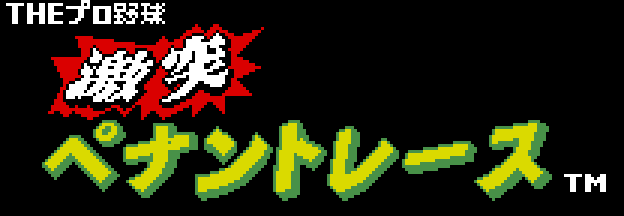

# Por dentro

## The Pro Yakyuu Gekitotsu Pennant Race (RC-757)

*The Pro Yakyuu Gekitotsu Pennant Race* (Konami, 1988) es el béisbol de Konami
para MSX2: seis equipos de serie, partidos contra el ordenador o entre dos, una
liga de hasta seis jugadores (PENNANT) y un editor de equipos (TEAM EDIT) que
graba en disco o en la SRAM del Game Master 2. Es un MegaROM de 128 KB con el
SCC.

Aquí está su código entero: los 131.072 bytes, en 16 bancos de 8 KB, se
vuelven a montar byte a byte, y el 43,7 % de las instrucciones va comentado.

### Qué hay en esta web

- [El juego](EL-JUEGO.html): los seis equipos con sus fichas, las reglas
  sacadas del código y los modos.
- [Las pantallas](LAS-PANTALLAS.html): el logo, la presentación animada, el
  menú, el campo en tres zonas, la pantalla del lanzamiento con sus letreros,
  el bateador, el lanzador y los jugadores animados, y la fuente, dibujados
  desde la ROM.
- [La música](LA-MUSICA.html): las 26 piezas, sacadas de su propio motor.
- [Los textos](LOS-TEXTOS.html): todo lo que escribe en pantalla.
- [El cartucho](POR-DENTRO.html): los bancos, los formatos de los dibujos y
  los textos, el sonido y la grabación.
- [El código](POR-DENTRO.html): cómo está hecho el desensamblado y cómo se
  vuelve a montar.
- [Hallazgos](CURIOSIDADES.html) y [Preguntas abiertas](CURIOSIDADES.html).

### Aquí no hay capturas

Todas las imágenes están dibujadas con código propio leyendo las tablas del
cartucho y comparadas con la VRAM de openMSX; cada pantalla dice cuánto
coincide. Las músicas salen de ejecutar el motor de sonido del cartucho y
coinciden con openMSX cuadro a cuadro.

### Montarlo

Hace falta la imagen del cartucho, que no se distribuye: `pennantrace.rom`,
el volcado GoodMSX (sha1 `e22a6317...`, 131.072 bytes), en la raíz.
`make verify` vuelve a montar los 16 bancos y comprueba que salen idénticos.

## El cartucho

### Los bancos

128 KB en 16 bancos de 8 KB con el mapper Konami SCC: cuatro ventanas
(`0x4000`, `0x6000`, `0x8000` y `0xA000`) que se cambian escribiendo el número
del banco en `0x5000`, `0x7000`, `0x9000` y `0xB000`. El banco `0x3F` en
`0x9000` abre el SCC en `0x9800`-`0x98FF`.

El banco 0 se queda siempre en `0x4000` y las otras tres ventanas se ponen de
tres en tres: 1-2-3 (`p00:438D`), 7-8-9 (`p00:4392`), 10-11-12 (`p00:4397`) y
13-14-15 (`p00:439F`). El reparto puesto se guarda en `0xDDF1`-`0xDDF3`. El
sonido pone los bancos 4-5-6 un momento y vuelve al reparto de antes.

| bancos | qué hay |
|---|---|
| p00 | el núcleo: el arranque, la interrupción, el despachador de estados (`p00:4220`), el VDP, los dibujos, los textos y las peticiones de sonido |
| p01-p03 | el partido: lanzamiento, bateo, corredores, defensa, cámara, marcador y orden de bateo |
| p04-p06 | el sonido: la tabla de 72 sonidos (`p04:600C`), las partituras (p05) y el motor (p06) |
| p07-p12 | los gráficos: paletas, dibujos, el mapa del campo (`p08:9432`) y sus mosaicos, los kanji (p09), los sprites (p10-p11) y la fuente (p12) |
| p13-p15 | los menús, PENNANT, TEAM EDIT, la grabación, la presentación y los seis equipos (`p13:731F`) |

### Los dibujos

Casi todo lo que se ve sale de listas de dibujos (`p00:4FA3`): un número de
fichas y, por ficha, 6 bytes `[paleta-tipo][VRAM][n][puntero]`. El tipo dice
cuántos bits lleva cada punto: 0 y 1, un bit; 2 y 3, dos; 4 y 5, tres. Los
impares se pintan en espejo. El nibble alto elige la paleta en una tabla que
da 2, 4 u 8 colores; cada combinación de bits es uno de ellos.

Lo grande va en rachas (`p00:4B35`): un byte de cuenta; 0 acaba, con el bit 7
a 0 repite el byte siguiente, `0x80` trae otro destino y de `0x81` a `0xFF`
copia los bytes tal cual.

### Los textos

`p00:4EA6` y sus hermanas ponen los bancos 13-14-15 y leen `[x y]` y
caracteres de la fuente hasta `0xFF`; `0xFE` trae otra posición y `0xFD` es
medio espacio. Ver [Los textos](LOS-TEXTOS.html).

### El sonido

Cada sonido tiene una cabecera (`p04:600A` + 2 × número): una máscara de
canales (bit 7 el canal 1, bit 0 el canal 8; del 1 al 3 el PSG, del 4 al 8 el
SCC), una prioridad y un puntero a la partitura de cada canal. En las
partituras, de `0xD0` a `0xFE` son órdenes (`p06:B92F`: la octava, la prioridad
y otras por una tabla), lo de debajo son notas y `0xFF` acaba. El motor
avanza cada canal en la interrupción (`p06:B41E`) y escribe el PSG y el SCC
(`p06:BBB8`). Ver [La música](LA-MUSICA.html).

### La grabación

TEAM EDIT y PENNANT graban en uno de tres sitios: la RAM, el disco o la SRAM
del Game Master 2 (`p13:6007`).

- **El disco** va por el BDOS (`0xF37D`). Antes de cada llamada se aparta la
  RAM del juego que pisaría el DOS (`p14:8334`) y después se devuelve.
- **El Game Master 2** se busca en los cuatro slots y sus subslots: es el
  cartucho que lleva `YZ` en `0x4010` (`p13:709A`). Para usarlo, pone su banco
  4 en `0x8000` y llama a `0x8000` con la orden en C: 5 el directorio, `0x0A`
  grabar y `0x0B` leer (`p13:721D`). La liga se graba con el nombre `PENAN`.
  Mientras tanto quita el gancho H.KEYI (H.TIMI para el directorio).

## El código

Un listado por banco en `src/pennantrace_pNN.asm` (de p00 a p15), que se monta
con pasmo y sale idéntico a la ROM: `make verify`. El 100 % del binario está
explicado: 50.191 bytes de código y 80.881 de datos. De las 25.026
instrucciones, el 43,7 % va comentado, y ninguna de las 2.933 rutinas queda
por debajo del mínimo de comentarios. Todos los bancos con código pasan del
40 %.

### Cómo está hecho

- `tools/z80trace.py` recorre el código desde sus entradas (el arranque, la
  interrupción y los despachadores) y separa código de datos.
- `tools/bancos.py` y `tools/cartucho.py` saben qué banco va en cada ventana:
  los repartos de tres en tres, los saltos entre bancos y las rutinas que
  vuelven con otro reparto (`tools/colas.py`).
- Los datos se identifican por quién los lee (`tools/lectores.py`): dibujos,
  rachas, textos, paletas, mosaicos, cabeceras y partituras de sonido.
- `tools/anota.py` comenta las variables, la BIOS, las llamadas y las fichas
  de los jugadores en el campo; `tools/check_refs.py` comprueba que cada
  referencia `pNN:XXXX` de los comentarios cae en una instrucción o un bloque
  de datos de ese banco.
- 12 pruebas (`tests/`) y `make sanity` vigilan el montaje y el trazado.

### Las imágenes y la música

- `tools/vram.py` es una VRAM de V9938 en Python con lo que usa el juego:
  dibujos, rachas, caracteres de un bit, órdenes de copia y paletas.
  `tools/pantallas.py` repite paso a paso las rutinas que pintan cada
  pantalla. `tools/sprites.py` pinta los sprites como el V9938 (con el bit CC)
  y monta el bateador y el lanzador como el juego; `tools/animaciones.py`
  saca los GIF con los tiempos del código. `tools/omsx_vram.tcl` vuelca la VRAM
  de openMSX y `tools/coteja_vram.py` compara.
- `tools/musica.py` ejecuta el motor de sonido en un Z80 de Python y saca los
  MP3; `tools/omsx_psg.tcl` y `tools/coteja_psg.py` lo cotejan con openMSX.
  La sonda deja pasar una sola petición del juego, puede poner a cero bytes
  de RAM en cada cuadro (el tono libre) y desvía el arranque del motor tras la
  primera vez.
- `tools/textos.py`, `tools/equipos.py` y `tools/fuente.py` sacan los textos,
  los equipos y la fuente.

## Código compartido con otros cartuchos de Konami

Este desensamblado se ha comparado, instrucción por instrucción, con
todos los demás de Konami de la serie. Cuenta un bloque cuando las
mismas instrucciones, al menos seis desde una etiqueta hasta su `ret`
o su salto sin condición, están en los dos cartuchos; las direcciones
no se miran, porque cambian de un cartucho a otro. De los otros 57,
**46** tienen al menos un bloque en común con este; estos son los
que más comparten:

| Cartucho | Bloques | Instrucciones | Por ejemplo (aquí = allí) |
|---|---:|---:|---|
| [Gekitotsu Pennant Race 2](https://antxiko.github.io/PennantRace2-disassembly/es/) | 119 | 1.758 | `dibujos` (p00:4FA3) |
| [King's Valley II](https://antxiko.github.io/KingsValley2-disassembly/es/) | 85 | 1.378 | `rachas_con_destino` (p00:4B2D) |
| [Parodius](https://antxiko.github.io/Parodius-disassembly/es/) | 71 | 1.189 | `sonido` (p00:57FF) = `pide_sonido` |
| [Salamander - Operation X](https://antxiko.github.io/Salamander-disassembly/es/) | 70 | 1.140 | `sonido` (p00:57FF) = `pide_sonido` |
| [Nemesis 3 - The Eve of Destruction](https://antxiko.github.io/Nemesis3-disassembly/es/) | 61 | 973 | `cartucho_en_pagina_2` (p00:43EC) = `cartucho_en_8000` |
| [Konami’s Game Master 2](https://antxiko.github.io/GameMaster2-disassembly/es/) | 59 | 976 | `rectangulo_desde_ram` (p00:4DAA) = `vdp_hmmc` |
| [Contra](https://antxiko.github.io/Contra-disassembly/es/) | 56 | 1.007 | `nota_empieza` (p06:B6AF) |
| [Hai no Majutsushi - Mahjong 2](https://antxiko.github.io/Majutsushi-disassembly/es/) | 52 | 581 | `cartucho_en_pagina_2` (p00:43EC) = `cartucho_en_8000` |
| [Shalom: Knightmare III](https://antxiko.github.io/Shalom-disassembly/es/) | 43 | 539 | `cartucho_en_pagina_2` (p00:43EC) = `cartucho_en_8000` |
| [F-1 Spirit — The Way to Formula 1](https://antxiko.github.io/F1Spirit-disassembly/es/) | 41 | 704 | `canal_ocupa` (p06:B305) = `SONIDO_CANAL` |

La matriz entera, los 58 cartuchos entre sí, está en
[Las rutinas](https://antxiko.github.io/MSX-disassembly-database/es/LAS-RUTINAS.html) de la base de datos de la
serie, con el método y el programa que la mide.
